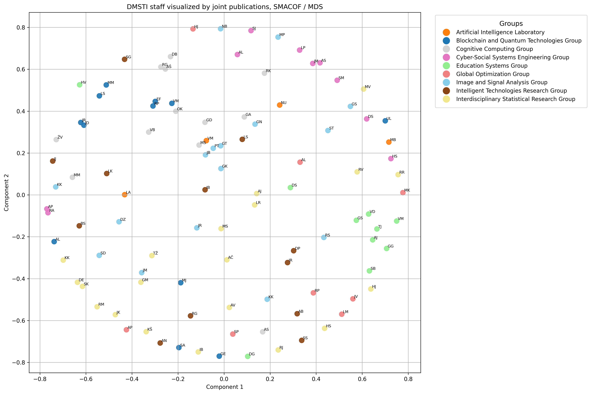
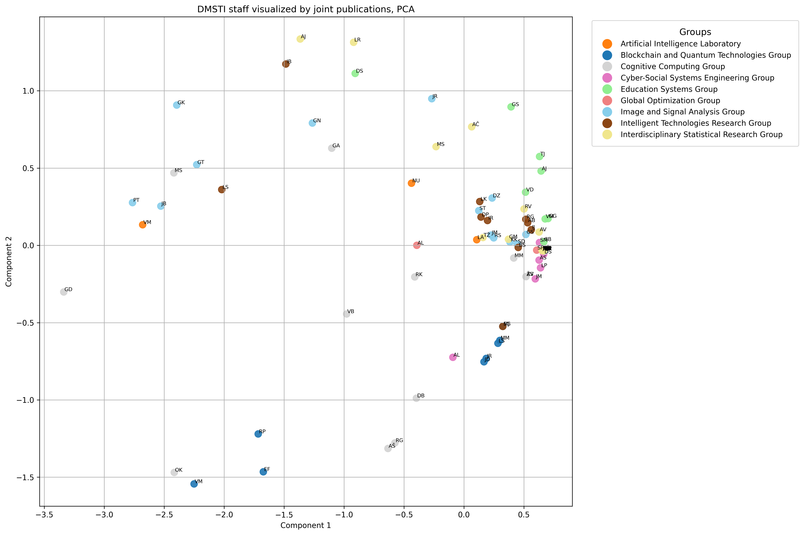

# DMSTI Co-authorship Visualization

This project builds a 2D map of DMSTI researchers (Institute of Data Science and Digital Technologies, Vilnius University) based on their joint publications. Each point is one researcher, and its color shows their research group. The more publications two people share, the closer they are on the map.

## How it works

1. **Staff.** The script parses the pages of 9 research groups on [mii.lt](https://www.mii.lt/en/structure/scientific-subdivisions) and collects the list of researchers (`dmsti_staff.csv`).
2. **Publications.** Publications for each researcher are downloaded from [eLABa](https://elaba.mb.vu.lt/dmsti/). Responses are cached in `dmsti_publications_cache.json`.
3. **Co-authorship matrix.** An `n × n` matrix is built where each cell holds the number of joint publications for a pair (`coauthor_matrix.csv`).
4. **Dissimilarity.** The matrix is transformed with `1 / (a + 1)` and used directly as the dissimilarity matrix (`transformed_matrix.csv`, `dissimilarity_matrix.csv`).
5. **Visualization.** The data is projected to 2D with two methods: **PCA** and **SMACOF / MDS**.

## Results

| Metric | Value |
|---|---|
| Researchers | 104 |
| Research groups | 9 |
| Pairs with joint publications | 284 |
| Max joint publications for one pair | 59 |
| SMACOF stress | ≈ 792.5 |

### SMACOF / MDS


### PCA


## Usage

```bash
pip install requests beautifulsoup4 numpy pandas matplotlib scikit-learn
python dmsti_visualization.py
```

The script regenerates all CSV files, plots and `summary_report.txt`.

## Files

| File | Contents |
|---|---|
| `dmsti_visualization.py` | main script |
| `dmsti_staff.csv` | researchers and their groups |
| `coauthor_matrix.csv` | joint publication counts |
| `transformed_matrix.csv` / `dissimilarity_matrix.csv` | matrix after `1/(a+1)` |
| `dmsti_pca.png`, `dmsti_smacof.png` | final visualizations |
| `summary_report.txt` | short summary report |
